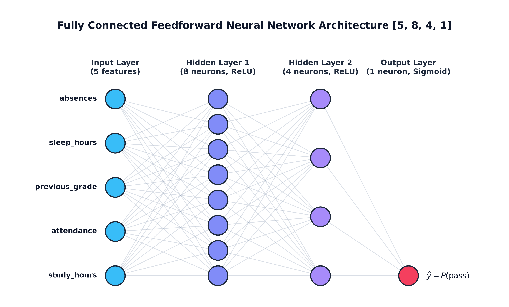
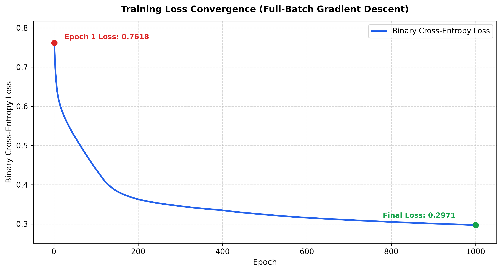
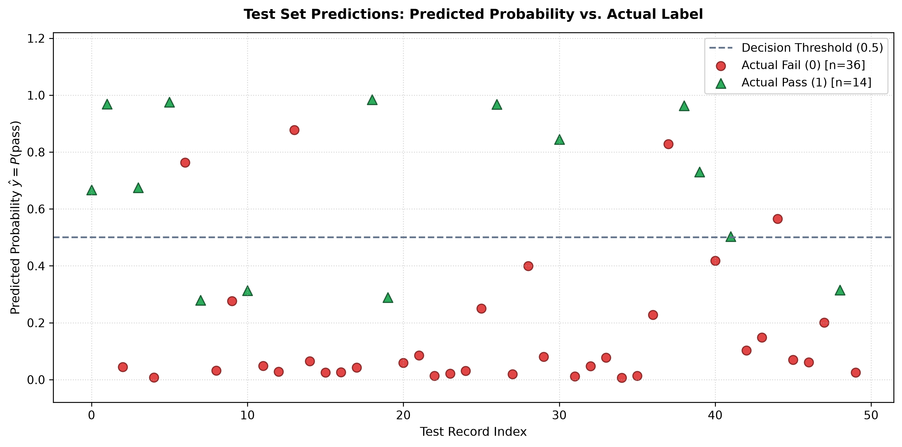

# Neural Network from Scratch in NumPy

A fully connected feedforward neural network implemented from scratch using **Python and NumPy**, without PyTorch, TensorFlow, or scikit-learn.

This project explores the fundamentals of deep learning, including forward propagation, activation functions, backpropagation, and gradient descent.

## Architecture

A binary classifier with the architecture **`[5, 8, 4, 1]`**:

- **Input Layer:** 5 input features
- **Hidden Layer 1:** 8 neurons with ReLU activation
- **Hidden Layer 2:** 4 neurons with ReLU activation
- **Output Layer:** 1 neuron with Sigmoid activation to predict the probability of passing

## Core Mathematics

| Concept                   | Explanation                                                                                                     |
| ------------------------- | --------------------------------------------------------------------------------------------------------------- |
| **Weight Initialization** | Uses He initialization to choose suitable starting weights for the network.                                     |
| **Forward Propagation**   | Combines inputs with weights and biases to calculate predictions.                                               |
| **Activation Functions**  | ReLU introduces non-linearity in hidden layers, while Sigmoid produces an output probability between 0 and 1.   |
| **Loss Function**         | Binary cross-entropy measures the difference between predicted probabilities and actual labels.                 |
| **Backpropagation**       | Uses the chain rule to calculate gradients and determine how weights and biases contribute to prediction error. |
| **Gradient Descent**      | Updates weights and biases using the calculated gradients to reduce the loss.                                   |

**Output Gradient:**

$$dZ = \hat{y} - y$$

For a Sigmoid output layer combined with binary cross-entropy loss, this simplified gradient is used during backpropagation.

Here, $\hat{y}$ is the predicted probability and $y$ is the actual label.

## Dataset

Uses `student_performance.csv`, containing 250 student records.

- **Input Features:** Study hours, attendance percentage, previous grade, sleep hours, and absences.
- **Target:** `pass` (1 = Pass, 0 = Fail).
- **Preprocessing:** Features are standardized using the mean and standard deviation calculated from the training set (80%) and then applied to the test set (20%).
- **Data Leakage Prevention:** `final_grade` is excluded because a grade of 50 or above directly determines the pass label.

## Results

**Training Configuration:** 1,000 epochs · Learning rate: 0.05 · Full-batch gradient descent

|  Training Loss  | Test Accuracy | Precision | Recall | F1-Score |
| :-------------: | :-----------: | :-------: | :----: | :------: |
| 0.7618 → 0.2971 |   **84.00%**  |   71.43%  | 71.43% |  71.43%  |

**Test BCE Loss:** `0.3293` · **Test Samples:** `50`

### Confusion Matrix

|             | Predicted Fail | Predicted Pass |
| ----------- | -------------: | -------------: |
| **Actual Fail** |             32 |              4 |
| **Actual Pass** |              4 |             10 |

## Implementation Highlights

- Calculated gradients using the chain rule without automatic differentiation.
- Built the forward pass, backward pass, and parameter updates using NumPy to understand the underlying mechanics of neural networks without relying on high-level deep learning frameworks.
